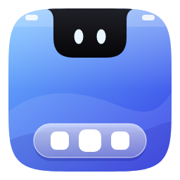
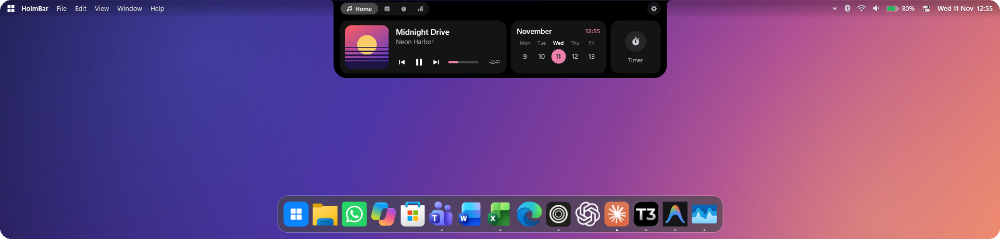
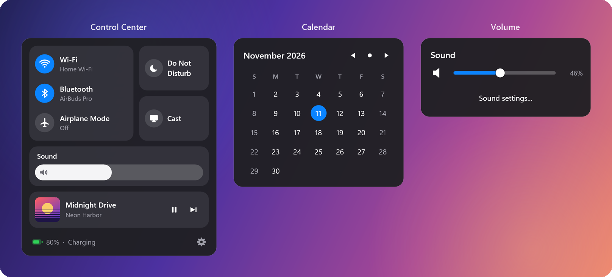
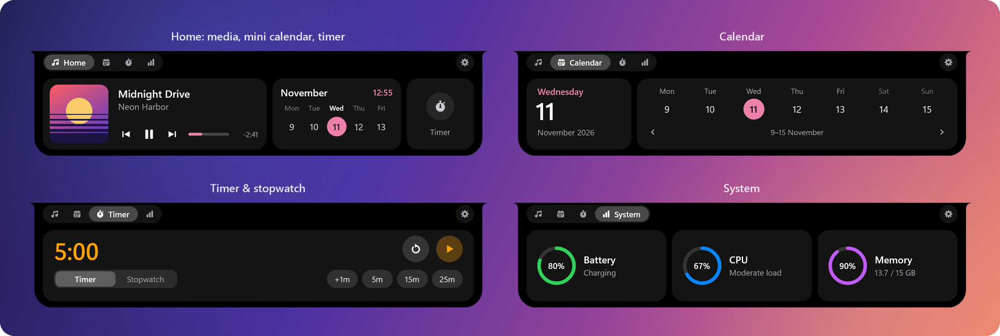
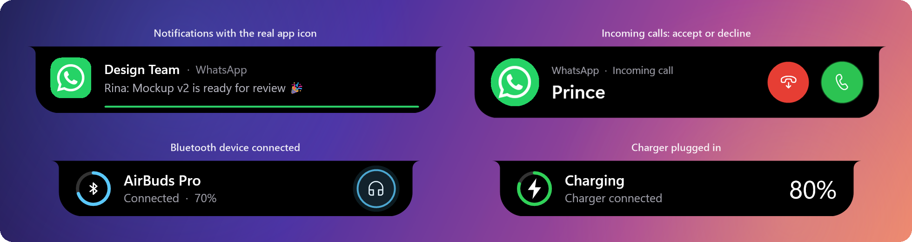
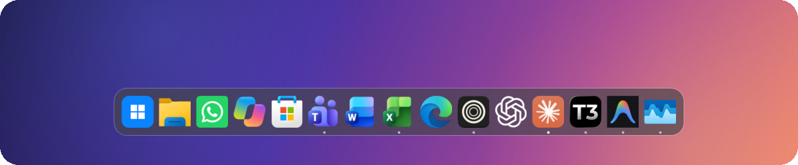
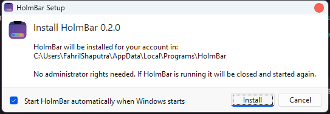

<div align="center">



# HolmBar

**Menu bar, notch, dan Dock bergaya macOS untuk Windows — dalam satu aplikasi native yang kecil.**

[Unduh](#pemasangan) · [Fitur](#fitur) · [Konfigurasi](#konfigurasi) · [Build dari sumber](#build-dari-sumber) · [English](README.md)



</div>

HolmBar menggantikan taskbar Windows dengan tiga bagian yang bekerja bersama: **menu bar** di atas layar,
**notch** (dynamic island) untuk media, timer, dan notifikasi, serta **Dock** di bawah. Semuanya satu file
executable native yang ditulis dengan Rust — tanpa Electron, tanpa runtime .NET, tanpa layanan latar.
Taskbar asli hanya disembunyikan, tidak pernah diubah, dan langsung kembali saat HolmBar keluar.

## Fitur

### Menu bar

- Menu logo Windows (pencarian, pengaturan, daya), nama aplikasi aktif, dan menu
  `File / Edit / View / Window / Help` yang mengirim pintasan standar ke aplikasi yang sedang fokus.
- Wi-Fi, Bluetooth, volume, baterai, dan jam, masing-masing dengan popup sendiri. Klik jam untuk kalender.
- **Control Center** berisi Wi-Fi, Bluetooth, Mode Pesawat, Jangan Ganggu, Proyeksi, kecerahan, volume, dan
  Sedang Diputar.
- **Ikon tray aplikasi pindah ke menu bar.** Discord, OneDrive, dan lainnya naik dari taskbar; klik kiri dan
  kanan diteruskan ke aplikasinya. Sisanya ada di balik panah overflow.
- **Solid atau transparan.** Nyalakan *Latar transparan* dan bar menyatu dengan wallpaper, dengan bayangan
  halus agar teks tetap terbaca.



### Notch

Arahkan kursor ke notch dan ia membuka menjadi panel bertab. Saat diam, notch menampilkan animasi kecil
(kucing, hujan yang mengikuti cuaca, akuarium yang mengikuti baterai, dan lainnya).

| Tab | Fungsi |
| --- | --- |
| **Beranda** | Sedang Diputar dengan sampul, kontrol, seek bar, dan lirik tersinkron, plus kalender mini dan pintasan timer |
| **Kalender** | Hari ini dan strip satu minggu yang bisa digeser |
| **Timer** | Hitung mundur dengan preset, atau stopwatch — tetap berjalan di notch ringkas |
| **Sistem** | Cincin baterai, CPU, dan memori |



### Notifikasi di notch

Notifikasi Windows tampil sebagai kartu di notch, bukan banner di pojok layar.

- **Ikon asli aplikasi, untuk semua aplikasi.** HolmBar mencari pengirim lewat indeks aplikasi terpasang
  (daftar yang sama dengan Start Menu), sehingga aplikasi Store maupun aplikasi desktop biasa mendapat ikon
  resolusi tinggi miliknya sendiri. Bila notifikasi membawa foto kontak, foto itu jadi gambar utama dan ikon
  aplikasi menjadi badge di sudutnya.
- Garis hitung mundur tipis menunjukkan berapa lama kartu tampil. Arahkan kursor untuk menahannya, klik untuk
  membuka notifikasinya.
- **Panggilan masuk** (WhatsApp, Teams, Phone Link, …) mendapat tombol Terima dan Tolak yang diteruskan ke
  notifikasi aslinya.
- Kartu saat **perangkat Bluetooth** tersambung (dengan level baterai) dan saat **pengisi daya dicolokkan**.
- Jangan Ganggu dihormati, dan teks notifikasi tidak pernah ditulis ke disk.



### Dock

- **Mengikuti pin taskbar Anda, dengan urutan yang sama** — termasuk aplikasi Store/paket seperti WhatsApp,
  Copilot, atau Microsoft Store, yang hanya tercatat di daftar registry taskbar. Pin atau unpin di Windows,
  Dock ikut berubah.
- Logo aplikasi tajam tanpa plat latar, diambil langsung dari paket aplikasinya seperti taskbar Windows 11.
- Indikator aplikasi berjalan, magnifikasi gelombang yang halus, pantulan saat membuka aplikasi, dan satu
  Dock per monitor yang menampilkan jendela di monitor itu.
- Sembunyi otomatis: `smart` (hanya saat ada jendela menutupinya), `always`, atau `off`.
- Klik kanan ikon untuk *Keep in Dock* / *Remove from Dock*. Tombol Windows membuka pencarian aplikasi.



### Lainnya

- Jendela **Pengaturan** bergaya macOS — semua opsi, langsung diterapkan.
- Menu konteks dan dialog konfirmasi yang digambar sendiri agar senada dengan UI lainnya.
- Peluncur aplikasi dengan pencarian fuzzy dan pintasan global opsional.
- Mendukung banyak monitor dan DPI per monitor.
- Bahasa Indonesia atau Inggris untuk bar, notch, dan popup (`general.language`).
- Berbasis event: tanpa polling untuk aplikasi aktif, media, volume, maupun Wi-Fi.

## Pemasangan

1. Unduh **`HolmBar-Setup-0.2.0.exe`** dari
   [rilis terbaru](https://github.com/fahrilshaputraa/holm/releases/latest).
2. Jalankan lalu klik **Pasang**. Tidak perlu hak administrator — HolmBar dipasang untuk akun Anda di
   `%LOCALAPPDATA%\Programs\HolmBar`.
3. HolmBar langsung berjalan. Biarkan *Jalankan HolmBar otomatis saat Windows dinyalakan* tercentang agar
   selalu aktif.



> **Windows SmartScreen.** Installer belum ditandatangani secara digital, jadi Windows bisa menampilkan
> *"Windows protected your PC"*. Pilih **More info → Run anyway**.

**Menghapus:** *Settings Windows → Apps → Installed apps → HolmBar*. Pengaturan Anda di `%APPDATA%\HolmBar`
tidak dihapus; hapus folder itu bila tidak diperlukan lagi.

Pemasangan senyap untuk skrip: `HolmBar-Setup-0.2.0.exe /S` (tambahkan `/noautostart` atau `/norun` bila perlu).

**Kebutuhan:** Windows 11, 64-bit. Windows 10 seharusnya bisa tetapi belum diuji.

## Cara pakai

| Untuk… | Lakukan |
| --- | --- |
| Membuka Pengaturan | Klik kanan menu bar atau Dock → **Settings…**, atau jalankan HolmBar sekali lagi dari Start Menu |
| Keluar (taskbar kembali) | Klik kanan menu bar → **Quit HolmBar** |
| Membuka notch | Arahkan kursor atau klik. Gulir di atasnya untuk pindah tab |
| Mencari aplikasi | Klik tombol Windows di Dock, atau atur pintasan di `[launcher]` |
| Mencoba kartu notifikasi | Klik kanan menu bar → **Preview notification** |

Bila HolmBar dimatikan paksa saat taskbar tersembunyi, jalankan HolmBar lagi lalu keluar secara normal —
taskbar dipulihkan saat HolmBar mulai dan saat keluar.

## Konfigurasi

Semua isi jendela Pengaturan disimpan di file TOML berkomentar: `%APPDATA%\HolmBar\config.toml`.
Perubahan dimuat otomatis, dan Anda cukup menulis nilai yang ingin diubah.

```toml
[bar]
transparent = true            # menu bar tembus pandang
right = ["tray", "bluetooth", "wifi", "volume", "battery", "control_center", "clock"]
clock_format = "%a %d %b  %H:%M"

[notch]
style = "notch"               # "notch" (menyatu dengan bar) atau "pill" (pulau melayang)
idle_animation = "aquarium"   # off, cat, rain, aquarium, fireflies, sky, plant, pulse, stars, wave
tabs = ["media", "calendar", "timer", "system"]

[dock]
autohide = "smart"            # off | smart | always
magnification = 1.7
import_taskbar_pins = true    # ikuti aplikasi yang di-pin di taskbar Windows

[notifications]
duration_ms = 5000
show_body = true
```

Daftar lengkap opsi beserta nilai bawaan dan penjelasannya ada di
[`src/default_config.toml`](src/default_config.toml).

## Privasi

HolmBar tidak punya akun, telemetri, maupun pengecekan pembaruan. Hanya ada dua jenis permintaan jaringan,
keduanya opsional:

- **Lirik** — judul, artis, dan durasi lagu dikirim ke [lrclib.net](https://lrclib.net).
  Matikan dengan `[lyrics] enabled = false`.
- **Cuaca** untuk animasi hujan — hanya nama kota yang Anda isi yang dikirim ke
  [Open-Meteo](https://open-meteo.com). Kosongkan `[weather] city` agar tidak ada yang dikirim.

Teks notifikasi dibaca dari banner di layar, ditampilkan di notch, dan hanya disimpan di memori.

## Build dari sumber

Butuh [toolchain Rust](https://rustup.rs) (stable). Dengan toolchain GNU, `windres` di `PATH` menyematkan
ikon aplikasi dan info versi; tanpanya build tetap berhasil.

```
cargo build --release
```

Aplikasinya ada di `target\release\holm-bar.exe`. Untuk membuat installernya juga:

```
powershell -ExecutionPolicy Bypass -File tools\build-installer.ps1
```

Hasilnya `dist\HolmBar-Setup-<versi>.exe`, installer mandiri dengan aplikasi tersemat di dalamnya.

```
cargo test --release
```

| Path | Isi |
| --- | --- |
| `src/bar.rs`, `popup.rs`, `control.rs`, `tray.rs` | Menu bar, popup-nya, Control Center, host ikon tray |
| `src/notch.rs`, `notifications.rs`, `apps.rs`, `idle.rs` | Notch, pembaca notifikasi, indeks aplikasi terpasang, animasi idle |
| `src/dock.rs`, `taskbar.rs` | Dock, pin taskbar, menyembunyikan dan memulihkan taskbar Windows |
| `src/settings.rs`, `config.rs`, `default_config.toml` | Jendela Pengaturan dan konfigurasi |
| `src/canvas.rs`, `icons.rs` | Lapisan gambar (bentuk GDI+, teks DirectWrite) dan ikon vektor |
| `installer/` | `HolmBar-Setup.exe` |
| `tools/` | Skrip ikon, tangkapan layar, dan installer |

## Lisensi

HolmBar adalah perangkat lunak bebas dengan lisensi **GNU General Public License v3.0**. Lihat [`LICENSE`](LICENSE).

Hak cipta (C) 2026 fahrilshaputraa. Anda boleh memakai, mempelajari, membagikan, dan mengubah HolmBar; bila Anda
mendistribusikan versi yang diubah, Anda wajib melakukannya dengan lisensi yang sama dan menyertakan kode sumbernya.
