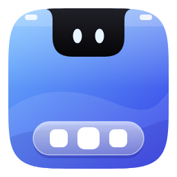
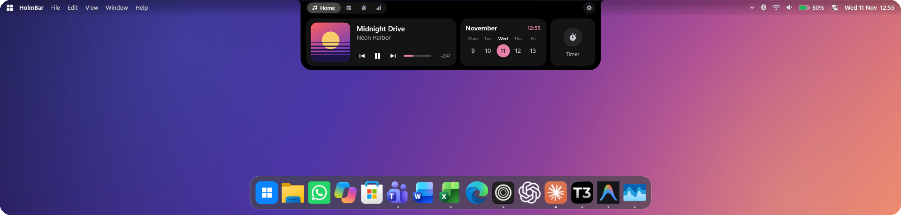
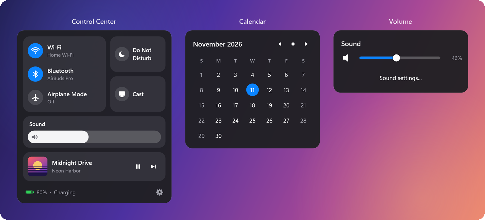
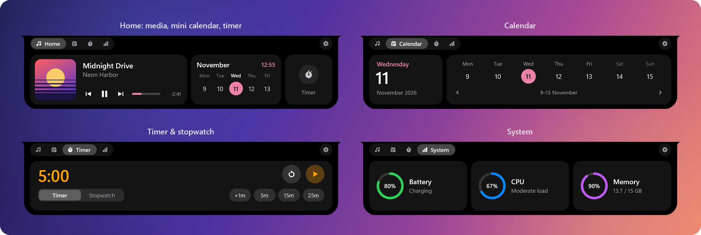
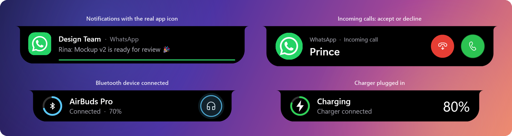
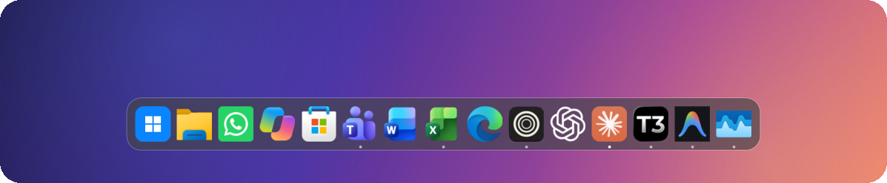
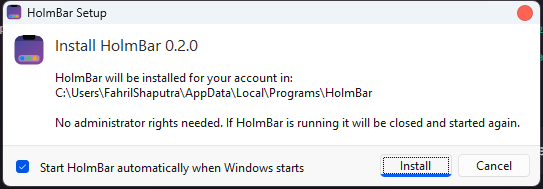

<div align="center">



# HolmBar

**A macOS-style menu bar, notch and Dock for Windows — in one small native app.**


[](LICENSE)

[Download](#install) · [Features](#features) · [Configuration](#configuration) · [Build from source](#build-from-source) · [Bahasa Indonesia](README.id.md)



</div>

HolmBar replaces the Windows taskbar with three pieces that work together: a **menu bar** at the top of the
screen, a **notch** (dynamic island) for media, timers and notifications, and a **Dock** at the bottom.
It is a single native executable written in Rust — no Electron, no .NET runtime, no background services.
The original taskbar is only hidden, never modified, and comes back the moment HolmBar quits.

## Features

### Menu bar

- Windows logo menu (search, settings, power), the active app's name, and `File / Edit / View / Window / Help`
  menus that send the standard shortcuts to the focused app.
- Wi-Fi, Bluetooth, volume, battery and clock, each with its own popup. Clicking the clock opens a calendar.
- **Control Center** with Wi-Fi, Bluetooth, Airplane Mode, Do Not Disturb, Cast, brightness, volume and
  Now Playing.
- **System tray icons live in the menu bar.** Discord, OneDrive and friends move up from the taskbar; left and
  right clicks are forwarded to the owning app. The rest sit behind an overflow arrow.
- **Solid or transparent.** Turn on *Transparent background* and the bar melts into your wallpaper, with a soft
  shadow that keeps text readable.



### Notch

Hover the notch and it springs open into a tabbed panel. When idle it shows a small ambient animation
(a cat, rain that follows the weather, an aquarium that follows your battery, and more).

| Tab | What it does |
| --- | --- |
| **Home** | Now Playing with artwork, transport controls, seek bar and synced lyrics, plus a mini calendar and a timer shortcut |
| **Calendar** | Today at a glance and a week strip you can page through |
| **Timer** | Countdown with presets, or a stopwatch — keeps running in the compact notch |
| **System** | Battery, CPU and memory rings |



### Notifications in the notch

Windows notifications appear as a card in the notch instead of a banner in the corner.

- **The real app icon, for every app.** HolmBar resolves the sender through the installed-apps index
  (the same list the Start menu uses), so Store apps and classic desktop apps both get their own
  high-resolution icon. When a notification carries a contact picture, the picture becomes the main image
  and the app icon turns into a corner badge.
- A thin countdown line shows how long the card stays. Hover to pause it, click to open the notification.
- **Incoming calls** (WhatsApp, Teams, Phone Link, …) get Accept and Decline buttons that are forwarded to the
  original notification.
- Cards for **Bluetooth devices** connecting (with battery level) and for **plugging in the charger**.
- Do Not Disturb is respected, and notification text is never written to disk.



### Dock

- **Mirrors your taskbar pins, in the same order** — including Store and packaged apps such as WhatsApp,
  Copilot or Microsoft Store, which only exist in the taskbar's registry list. Pin or unpin something in
  Windows and the Dock follows.
- Crisp, unplated app logos loaded straight from each app package, like the Windows 11 taskbar.
- Running indicators, smooth wave magnification, launch bounce, and one Dock per monitor showing the windows
  that live there.
- Auto-hide: `smart` (hides only when a window overlaps it), `always`, or `off`.
- Right-click an icon for *Keep in Dock* / *Remove from Dock*. The Windows button opens the app launcher.



### And also

- A macOS-style **Settings** window — every option, applied live.
- Hand-drawn context menus and confirmation dialogs that match the rest of the UI.
- An app launcher with fuzzy search and an optional global hotkey.
- Multi-monitor and per-monitor DPI aware.
- Indonesian or English for the bar, notch and popups (`general.language`). The Settings window is
  Indonesian for now.
- Event-driven: no polling loops for the foreground app, media, volume or Wi-Fi.

## Install

1. Download **`HolmBar-Setup-0.2.0.exe`** from the
   [latest release](https://github.com/fahrilshaputraa/holm/releases/latest).
2. Run it and click **Install**. No administrator rights are needed — HolmBar installs for your user account
   into `%LOCALAPPDATA%\Programs\HolmBar`.
3. HolmBar starts right away. Leave *Start HolmBar automatically when Windows starts* ticked to keep it.



> **Windows SmartScreen.** The installer is not code-signed yet, so Windows may show *"Windows protected your
> PC"*. Choose **More info → Run anyway**.

**Uninstall** from *Windows Settings → Apps → Installed apps → HolmBar*. Your settings in `%APPDATA%\HolmBar`
are kept; delete that folder if you no longer want them.

Silent install for scripts: `HolmBar-Setup-0.2.0.exe /S` (add `/noautostart` or `/norun` as needed).

**Requirements:** Windows 11, 64-bit. Windows 10 should work but has not been tested.

## Using HolmBar

| To… | Do this |
| --- | --- |
| Open Settings | Right-click the menu bar or Dock → **Settings…**, or launch HolmBar again from the Start menu |
| Quit (and get the taskbar back) | Right-click the menu bar → **Quit HolmBar** |
| Open the notch | Hover it, or click it. Scroll over it to switch tabs |
| Search apps | Click the Windows button in the Dock, or set a hotkey under `[launcher]` |
| Try the notification cards | Right-click the menu bar → **Preview notification** |

If HolmBar is ever force-killed while the taskbar is hidden, start HolmBar again and quit it normally —
it restores the taskbar on startup and on exit.

## Configuration

Everything in the Settings window is stored in a commented TOML file at `%APPDATA%\HolmBar\config.toml`.
Edits are picked up automatically, and you only need to list the values you want to change.

```toml
[bar]
transparent = true            # see-through menu bar
right = ["tray", "bluetooth", "wifi", "volume", "battery", "control_center", "clock"]
clock_format = "%a %d %b  %H:%M"

[notch]
style = "notch"               # "notch" (fused with the bar) or "pill" (floating island)
idle_animation = "aquarium"   # off, cat, rain, aquarium, fireflies, sky, plant, pulse, stars, wave
tabs = ["media", "calendar", "timer", "system"]

[dock]
autohide = "smart"            # off | smart | always
magnification = 1.7
import_taskbar_pins = true    # mirror the apps pinned to the Windows taskbar

[notifications]
duration_ms = 5000
show_body = true
```

The full list of options, with defaults and explanations, is in
[`src/default_config.toml`](src/default_config.toml).

## Privacy

HolmBar has no account, no telemetry and no update pings. It makes exactly two kinds of network requests, both
optional:

- **Lyrics** — the song title, artist and duration are sent to [lrclib.net](https://lrclib.net).
  Disable with `[lyrics] enabled = false`.
- **Weather** for the rain animation — only the city name you typed is sent to
  [Open-Meteo](https://open-meteo.com). Leave `[weather] city` empty to send nothing.

Notification text is read from the banner on screen, shown in the notch, and kept in memory only.

## Build from source

You need the [Rust toolchain](https://rustup.rs) (stable). With the GNU toolchain, `windres` on `PATH` embeds
the app icon and version info; without it the build still succeeds.

```
cargo build --release
```

The app is `target\release\holm-bar.exe`. To build the installer as well:

```
powershell -ExecutionPolicy Bypass -File tools\build-installer.ps1
```

This produces `dist\HolmBar-Setup-<version>.exe`, a self-contained installer with the app embedded.

```
cargo test --release
```

| Path | Contents |
| --- | --- |
| `src/bar.rs`, `popup.rs`, `control.rs`, `tray.rs` | Menu bar, its popups, Control Center, tray icon host |
| `src/notch.rs`, `notifications.rs`, `apps.rs`, `idle.rs` | Notch, notification reader, installed-apps index, idle animations |
| `src/dock.rs`, `taskbar.rs` | Dock, taskbar pins, hiding and restoring the Windows taskbar |
| `src/settings.rs`, `config.rs`, `default_config.toml` | Settings window and configuration |
| `src/canvas.rs`, `icons.rs` | Drawing layer (GDI+ shapes, DirectWrite text) and vector icons |
| `installer/` | `HolmBar-Setup.exe` |
| `tools/` | Icon, screenshot and installer scripts |

## License

HolmBar is free software, licensed under the **GNU General Public License v3.0**. See [`LICENSE`](LICENSE).

Copyright (C) 2026 fahrilshaputraa. You may use, study, share and modify HolmBar; if you distribute a modified
version, you must do so under the same license and make its source available.
