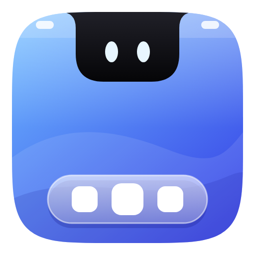

# HolmBar brand guide

## The idea

The icon is a tiny screen holding the three parts of HolmBar: the **menu bar** along the top, the **notch**
hanging from it (with the two eyes it shows when idle), and the **Dock** below. One colour family, depth from
gradient and light rather than extra colours.

## Files

| File | Use |
| --- | --- |
| `holmbar-icon.svg` | Master app icon (48 px and larger) |
| `holmbar-icon-small.svg` | Simplified cut for 16-32 px: no menu bar, bigger notch, eyes and Dock |
| `holmbar-glyph-black.svg` | One-colour glyph without the tile (print, stamps, light backgrounds) |
| `holmbar-glyph-white.svg` | One-colour glyph for dark backgrounds and menu-bar style uses |
| `holmbar-icon-512.png` | Ready-made raster |

`res/holmbar.ico` (used by the exe and installer) is built from the icon files: the small cut for 16, 24 and
32 px, the full icon for 48 px and up. Regenerate everything with `py -3 tools/make-logo.py`.

## Colour

| Role | Value |
| --- | --- |
| Tile gradient | `#6CB8FF` to `#3540E6` (top-left to bottom-right) |
| Notch | `#202028` to `#050507` |
| Eyes | `#E8F6FF` |
| Dock glass and apps | white, 62% to 30% opacity glass, apps solid white |

## Usage

- **Clear space:** keep at least the width of one Dock app (about 1/10 of the icon width) free around the icon.
- **Minimum size:** the full icon down to 48 px; below that use `holmbar-icon-small.svg`.
- **Backgrounds:** the tile works on any background. Use the black or white glyph only where colour is not possible.
- **Don't:** recolour the tile, stretch or rotate the icon, add extra shadows or outlines, or change the number
  of Dock apps.
